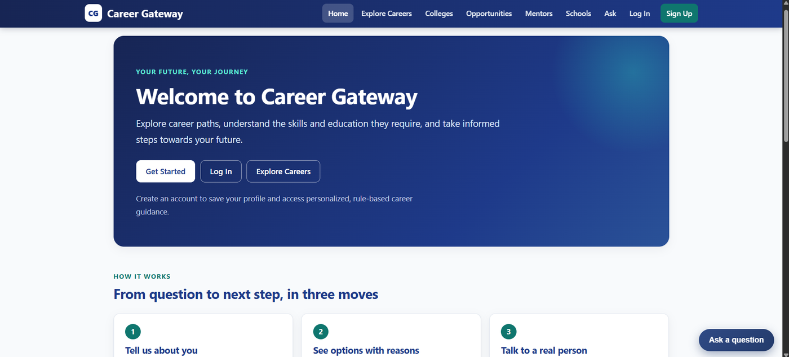
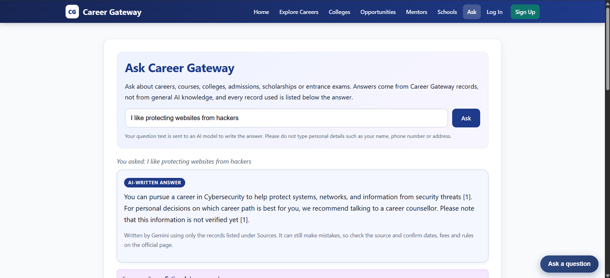
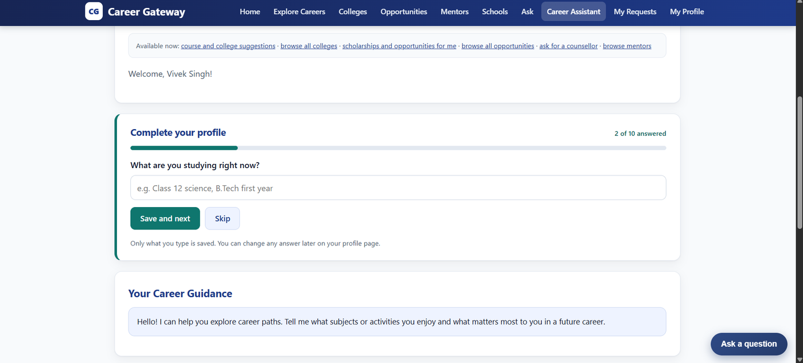
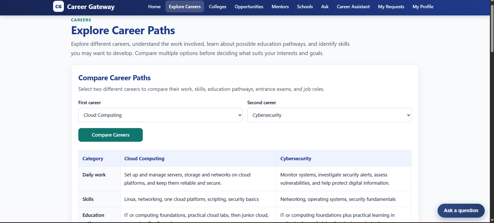
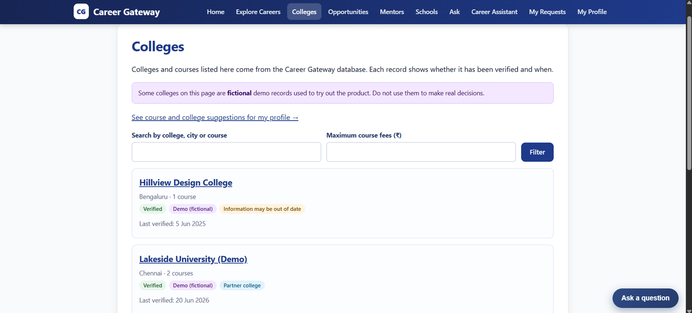
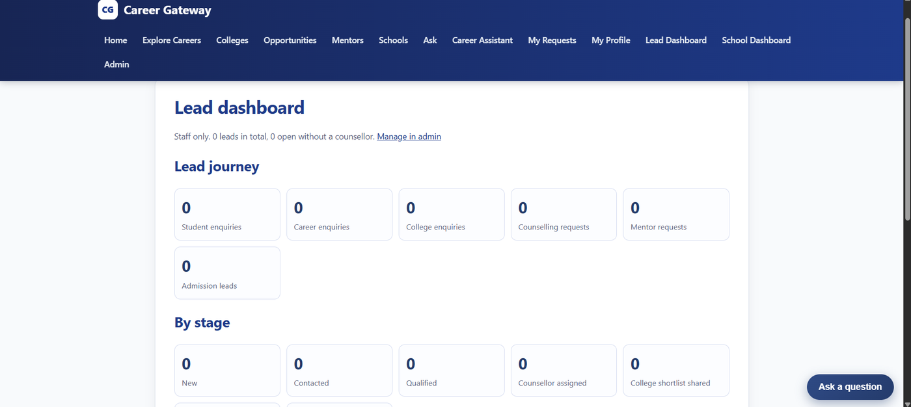

# Career Gateway: AI Career Assistant

**AI for access. Counsellors for guidance. Professionals for experience.**

Career Gateway is a Django web application that helps students explore careers, colleges, scholarships and mentors, and then connects them to a human counsellor for decisions that matter. The assistant helps students explore. It does not replace a counsellor.

It is built from the *Career Gateway: AI Career Assistant, Product and Integration Plan* (18 sections). The table below maps each section of that plan to what exists in the code.

**Live demo:** https://careergateway.onrender.com
(Runs on a free Render instance. After a period of inactivity the first page can take about a minute to wake up.)


---

## Highlights

- **Ask Career Gateway:** answers written by a free LLM, only from the project's own records, with numbered sources and a "not verified yet" label where it applies.
- **Hybrid search (words + meaning):** keyword matching combined with Gemini embeddings, so a question like *"I like protecting websites from hackers"* finds **Cybersecurity** even though the word never appears in the question.
- **Guided profile building:** the Assistant asks one profile question at a time, with Skip, a progress bar and validation.
- **Transparent matching:** colleges and opportunities come with the reason they were suggested. Hard limits exclude with a reason, preferences only reorder, and unknown data is flagged.
- **Human handoff:** seven trigger situations and a counsellor request form, with a lead dashboard for staff.
- **Honest about data:** every record shows whether it is verified, when it was checked, and whether it is demo data.


## Screenshots

| | |
|---|---|
|  |  |
| **Home** | **Ask Career Gateway:** AI-written answer with sources |
|  |  |
| **Guided profile building** (one question at a time, Skip, progress bar) | **Compare two careers** |
|  |  |
| **Colleges:** verified / demo labels on every record | **Staff lead dashboard** |

---

## What is built (mapped to the plan)

| Plan section | What exists |
|---|---|
| 1-3 Positioning, first conversation | "Career Assistant" with 7 starting options |
| 4 Student profile | Guided profile capture: the Assistant page asks 10 profile questions one at a time (Skip, progress bar, validation). Full profile form on the Profile page |
| 5-6 Career discovery and explanation | Career pages with structured information and FAQs; compare two careers; transparent matching with reasons |
| 7 College recommendation | College and course database, rule-based matching (hard limits exclude with a reason, preferences only reorder, unknown data flagged, partner status disclosed) |
| 8 Counsellor handoff | Seven trigger situations and a counsellor request form |
| 9 Mentors | Mentor profiles for ten professions, "request a session" |
| 10 Opportunities | Scholarships, internships, competitions and more, matched on eligibility, level, location and deadline |
| 11 School version | School programs page, registration with minor-privacy safeguards, staff dashboard (counts only) |
| 12 Architecture | `/how-it-works/` page |
| 13 Knowledge base and RAG | Controlled knowledge base; retrieval; a free LLM writes the answer from the retrieved records only |
| 14 Admin dashboard | Lead dashboard, counsellor assignment, shortlist, application status |
| 15 Revenue | Tier labels only (free, lead, paid, admission, long-term). No payments |
| 16 MVP technology | Python/Django, mobile-responsive chat widget, SQLite or PostgreSQL via `DATABASE_URL`, free LLM (Gemini or Ollama), **embeddings with similarity search**, deployed on Render |

---

## How it works

```
Student question
      |
      v
Retrieval over the knowledge base (careers, colleges, mentors, opportunities, FAQs)
      |-- word-overlap ranking ---------------------.
      '-- embedding similarity (Gemini, cosine) ----+--> merged, ranked records
                                                    |
                                                    v
                          LLM writes an answer ONLY from those records
                                                    |
                                                    v
                    Answer + numbered sources + "not verified" labels
                                                    |
                                                    v
                          Human counsellor / mentor for big decisions
```

### Hybrid retrieval

1. **Word match:** each record is scored by how many query words it shares.
2. **Meaning match:** the question and every record are turned into vectors with the Gemini embedding model (`gemini-embedding-001`, 768 dimensions). Records are compared by cosine similarity. Only matches above a minimum similarity (default `0.55`) and within a small window of the best match are kept.
3. **Merge:** meaning hits are ranked by similarity, with a small bonus if the words also match. Word-only hits follow.
4. **Fallback:** if embeddings are switched off, not built, or the API fails, retrieval behaves exactly like plain word matching. The site never depends on the embedding service to work.

Example from `python manage.py check_embeddings`:

```
Q: "I like protecting websites from hackers"
  words only  : How do I prepare for an entrance exam?; Software Development; ...
  with meaning: Cybersecurity [meaning, 0.66]; Software Development [both, 0.607]; ...
```

Vectors are stored as JSON in the application database (`RecordEmbedding` model), which is enough at this size. A dedicated vector store such as pgvector is the production upgrade.

---

## Tech stack

| Area | Choice |
|---|---|
| Backend | Python 3.11, Django 5.2 |
| Database | SQLite locally; PostgreSQL via `DATABASE_URL` (used on Render) |
| AI answers | Gemini (free tier) or Ollama; `LLM_PROVIDER=none` shows retrieved records only |
| Embeddings | Gemini `gemini-embedding-001`, cosine similarity |
| Static files / server | WhiteNoise, Gunicorn |
| Hosting | Render (free web service + free PostgreSQL) |
| Tests | Django test runner, 384 tests, no network calls |

---

## Honest limits (please read)

- **No separate vector database.** Embeddings are stored in the project's own database as JSON. Fine for this size; pgvector is the production upgrade.
- **All colleges, opportunities and mentors in the demo are fictional** and labelled that way. Knowledge entries and career texts are **not verified** yet and are labelled that way.
- **No booking, payments, SMS or email sending.** Requests are recorded as leads. Pages say that nothing is booked.
- The language model can still make mistakes. It is told to answer only from the retrieved records and to say so when it cannot.
- Free AI services may use question text to improve their products, so the pages ask users not to enter personal details. Only the question and public record text are sent to the model, never profile or contact data.
- Guided profile building is a set of fixed questions, not free-text conversation, so the assistant does not extract details from sentences.
- School version has programs, registration and a dashboard, but no separate per-school environments or teacher accounts yet.
- The demo runs on free hosting: the app sleeps when idle and the free database expires after 30 days.
- The Gemini free-tier quota for embeddings is not officially confirmed. Embeddings are built in small batches with pauses and retries, and the site falls back to word matching if the service is unavailable.

---

## Run it locally (Windows PowerShell)

```powershell
cd C:\CareerGateway
python -m venv .venv
.\.venv\Scripts\Activate.ps1
pip install -r requirements.txt
copy .env.example .env      # then edit .env (set DJANGO_SECRET_KEY)
python manage.py migrate
python manage.py seed_careers
python manage.py seed_knowledge
python manage.py seed_demo_colleges
python manage.py seed_demo_opportunities
python manage.py seed_demo_mentors
python manage.py seed_demo_school_programs
python manage.py build_embeddings      # needs GEMINI_API_KEY; optional
python manage.py createsuperuser
python manage.py runserver
```

Generate a secret key with:

```
python -c "from django.core.management.utils import get_random_secret_key as g; print(g())"
```

### Environment variables

Set these in `.env` (never commit it). See `.env.example` for the full list.

| Name | Purpose |
|---|---|
| `DJANGO_SECRET_KEY` | Required. A long random value |
| `DJANGO_DEBUG` | `True` locally, `False` in production |
| `DATABASE_URL` | Optional. `postgres://...` switches from SQLite to PostgreSQL |
| `LLM_PROVIDER` | `gemini`, `ollama` or `none` |
| `GEMINI_API_KEY` | Free key from https://aistudio.google.com/apikey |
| `GEMINI_MODEL` / `GEMINI_FALLBACK_MODEL` | Model names for answers |
| `GEMINI_EMBEDDING_MODEL` | Default `gemini-embedding-001` |
| `EMBEDDING_DIMENSIONS` | Default `768` |
| `EMBEDDING_MIN_SIMILARITY` | Default `0.55` |
| `EMBEDDINGS` | Set to `off` to disable embeddings |

Model names change over time; check Google AI Studio for the free models on your account. To use a local model instead, set `LLM_PROVIDER=ollama` and `OLLAMA_MODEL=llama3.2`.

### Check the AI parts

```
python manage.py check_llm          # calls the real model and checks the answer is not copied text
python manage.py check_embeddings   # compares word-only search with word + meaning search
```

---

## Tests

```
python manage.py test
```

384 tests. The suite uses a mocked model and stubbed embedding calls, so it never calls the internet or uses your quota.

---

## Staff pages

Log in as a staff user. The navbar then shows **Lead Dashboard** (`/staff/leads/`), **School Dashboard** (`/staff/school/`) and **Admin** (`/admin/`) for records. These links are hidden from normal students.

---

## Project layout

```
config/          Django settings, URLs, WSGI, database URL parsing
core/
  models.py            Careers, colleges, mentors, opportunities, leads, profiles, embeddings
  retrieval.py         Hybrid word + meaning retrieval
  embeddings.py        Gemini embeddings, cosine similarity, caching
  llm.py               LLM calls with retry and fallback model
  profile_capture.py   Guided profile questions and validation
  views_*.py           Ask, leads, school, profile-step views
  templates/           Pages and shared base layout
  management/commands/ seed_*, build_embeddings, check_embeddings, check_llm
DEPLOY.md              Deployment guide
PROJECT_CHECKPOINT.md  Requirement-by-requirement progress log
```

---

## Deploy

The project runs on Render with a free web service and a free PostgreSQL database. See [DEPLOY.md](DEPLOY.md) for the build command, start command and environment variables. Real secrets are set only in the host's settings, never in the repository.

---

## Before real students use it

Replace the fictional demo data with real, verified records, review the knowledge entries, get consent for real mentors, review the privacy notice for minors, and move to a paid, always-on instance and database.
